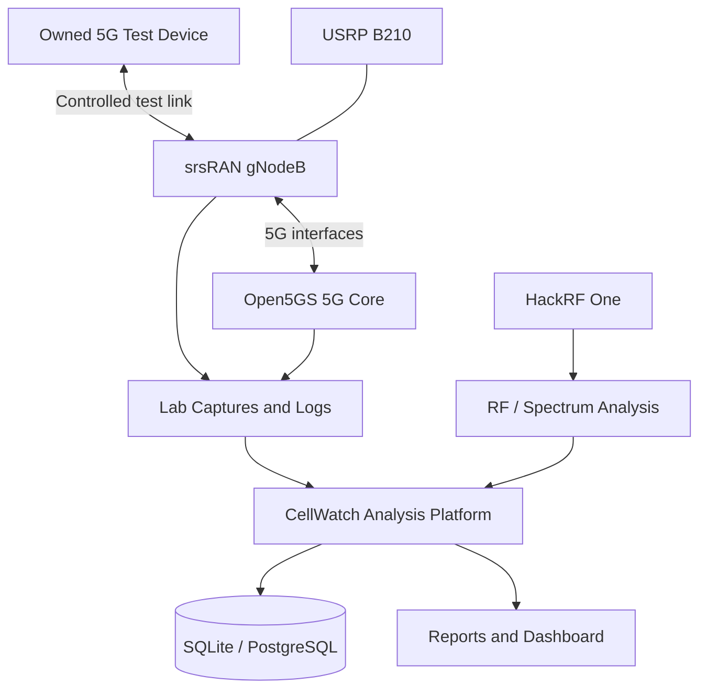

# CellWatch 5G Research Lab

**Understanding Cellular Networks Through Controlled Research.**

**Choose your language / Sprache auswählen:**  [🇩🇪 Deutsch](#deutsch) · [🇬🇧 English](#english)

[](https://www.debian.org/)
[](#research-focus)
[](#roadmap)

CellWatch 5G Research Lab is an independent, privately operated research project focused on 5G mobile networks, software-defined radio (SDR), cellular architecture and defensive network security. The lab is designed for controlled experiments using owned hardware, test devices and test SIMs.

**Research is limited to systems and radio environments for which the operator has the necessary authorization.** No third-party subscribers or public mobile networks are targets of this project.

---

<a name="deutsch"></a>
## 🇩🇪 Deutsch

### Projektüberblick

Das CellWatch 5G Research Lab ist ein privates Forschungsprojekt zur Untersuchung von 5G-Mobilfunknetzen, SDR-Technologie und Netzwerksicherheit. Im Mittelpunkt stehen 5G-Standalone-Architekturen (5G SA), das Zusammenspiel von Radio Access Network (RAN) und 5G Core, Mobilfunkprotokolle sowie defensive Sicherheitsanalysen.

Die Experimente erfolgen ausschließlich in einer kontrollierten Laborumgebung mit eigener Testhardware, eigenen Testgeräten und Test-SIM-Karten.

### Forschungsbereiche

- **5G-Architektur:** Grundlagen von 5G SA, RAN, gNodeB und 5G Core.
- **SDR-Technologie:** Verständnis und Einsatz programmierbarer Funkhardware.
- **Mobilfunkprotokolle:** Untersuchung und Dokumentation von Protokollabläufen in eigenen Testaufbauten.
- **Teilnehmeridentitäten:** Fachliche Untersuchung von SUPI, SUCI und den zugehörigen Schutzmechanismen.
- **Authentifizierung:** Analyse der Sicherheitsziele und Abläufe der 5G-Authentifizierung im Labor.
- **Defensive Sicherheit:** Erkennen und Bewerten auffälliger Netzmerkmale sowie Entwicklung einer eigenen Monitoring- und Analyseplattform namens CellWatch.

### Geplante Laborhardware

| Komponente | Aufgabe |
|---|---|
| Ettus USRP B210 | Primäre SDR-Plattform für geeignete 5G-Laborversuche |
| HackRF One | Ergänzende RF- und Spektrumanalyse, kein alleiniger 5G-gNodeB-Ersatz |
| 5G-Testgeräte | Eigene Endgeräte für kontrollierte Verbindungsversuche |
| Test-SIM-Karten | Ausschließlich für das eigene Testnetz vorgesehene Teilnehmerprofile |

Die USRP B210 bietet 2x2-MIMO und bis zu 56 MHz momentane Bandbreite. Ob eine konkrete 5G-Konfiguration damit möglich ist, hängt unter anderem von Frequenzband, Kanalbandbreite, Softwarestand und Systemkonfiguration ab. Der HackRF One ist als ergänzendes Analysewerkzeug vorgesehen.

### Software-Stack

- Debian GNU/Linux 13 (Trixie)
- UHD (USRP Hardware Driver)
- srsRAN Project
- Open5GS
- GNU Radio
- Wireshark
- Python 3
- SQLite und/oder PostgreSQL

### Sicherheit und rechtlicher Rahmen

Das Labor ist für Forschung an eigenen Systemen und in kontrollierten Funkumgebungen vorgesehen. Es werden keine fremden Mobiltelefone, Teilnehmerkennungen oder öffentlichen Mobilfunknetze gezielt untersucht oder beeinträchtigt.

Eine Abschirmung allein ersetzt keine erforderliche Frequenzzuteilung oder sonstige behördliche Genehmigung. Funkübertragungen erfolgen nur, wenn die rechtlichen und technischen Voraussetzungen dafür erfüllt sind. Wo dies nicht gegeben ist, werden Experimente leitungsgebunden, in geeigneten abgeschirmten Aufbauten oder mit aufgezeichneten Testdaten durchgeführt.

---

<a name="english"></a>
## 🇬🇧 English

### Project Overview

CellWatch 5G Research Lab is an independent, privately operated research project exploring 5G mobile networks, software-defined radio (SDR), cellular architecture and defensive network security. Its main focus is 5G Standalone (5G SA), the interaction between the Radio Access Network (RAN) and the 5G Core, cellular protocols and defensive security analysis.

Experiments are conducted in a controlled laboratory environment using owned test hardware, test devices and test SIM cards.

### Research Focus

- **5G architecture:** 5G SA fundamentals, RAN, gNodeB and the 5G Core.
- **SDR technology:** Understanding and using programmable radio hardware.
- **Cellular protocols:** Investigating and documenting protocol behavior in privately operated test setups.
- **Subscriber identities:** Studying SUPI, SUCI and their privacy protections.
- **Authentication:** Analyzing 5G authentication procedures and security goals in the lab.
- **Defensive security:** Identifying and assessing unusual network characteristics and developing the CellWatch monitoring and analysis platform.

### Planned Lab Hardware

| Component | Purpose |
|---|---|
| Ettus USRP B210 | Primary SDR platform for suitable 5G lab experiments |
| HackRF One | Supplementary RF and spectrum analysis, not a standalone 5G gNodeB replacement |
| 5G test devices | Owned devices for controlled connectivity experiments |
| Test SIM cards | Subscriber profiles dedicated to the private test network |

The USRP B210 supports 2x2 MIMO and up to 56 MHz of instantaneous bandwidth. Suitability for a specific 5G configuration depends on the band, channel bandwidth, software and system configuration. The HackRF One is intended as a complementary analysis tool.

### Software Stack

- Debian GNU/Linux 13 (Trixie)
- UHD (USRP Hardware Driver)
- srsRAN Project
- Open5GS
- GNU Radio
- Wireshark
- Python 3
- SQLite and/or PostgreSQL

### Safety and Legal Scope

The lab is intended for research on owned systems and in controlled radio environments. Third-party phones, subscriber identities and public mobile networks are not targets.

RF shielding does not replace any required spectrum assignment or regulatory authorization. Radio transmissions will only be performed when all legal and technical requirements are met. Otherwise, experiments will use conducted connections, suitable shielded setups or recorded test data.

---

## Architecture at a Glance



See [docs/architecture.md](docs/architecture.md) for more detail.

## Repository Structure

```text
CellWatch-5G-Research-Lab/
├── README.md
├── LICENSE
├── docs/
│   ├── architecture.md
│   ├── hardware.md
│   ├── software-installation.md
│   ├── debian-13-setup.md
│   ├── 5g-fundamentals.md
│   ├── subscriber-identities.md
│   └── security-research.md
├── hardware/
│   ├── usrp-b210/
│   ├── hackrf-one/
│   └── rf-laboratory/
├── software/
│   ├── srsran/
│   ├── open5gs/
│   ├── gnuradio/
│   └── cellwatch/
├── analysis/
│   ├── spectrum/
│   ├── protocols/
│   ├── identities/
│   └── security/
├── experiments/
│   ├── experiment-01/
│   ├── experiment-02/
│   └── experiment-03/
├── scripts/
└── data/
    └── .gitkeep
```

## Roadmap

- [ ] **01** — Prepare the Debian 13 research workstation.
- [ ] **02** — Set up the HackRF One and learn SDR fundamentals.
- [ ] **03** — Install and configure the Open5GS 5G Core.
- [ ] **04** — Integrate srsRAN Project with the USRP B210.
- [ ] **05** — Establish a private, authorized 5G SA test environment.
- [ ] **06** — Study subscriber identity protection and authentication.
- [ ] **07** — Document 5G protocol behavior and defensive security findings.
- [ ] **08** — Implement the CellWatch monitoring and analysis components.
- [ ] **09** — Add database storage and a research dashboard.
- [ ] **10** — Publish reproducible experiments and technical documentation.

## Documentation

- [Architecture](docs/architecture.md)
- [Hardware overview](docs/hardware.md)
- [Software installation plan](docs/software-installation.md)
- [Debian 13 workstation setup](docs/debian-13-setup.md)
- [5G fundamentals](docs/5g-fundamentals.md)
- [Subscriber identities](docs/subscriber-identities.md)
- [Security research scope](docs/security-research.md)

## Contributions and Research Notes

This repository is a work in progress. Documentation, reproducible lab notes and carefully scoped defensive research contributions are welcome. Do not submit personal data, third-party subscriber identifiers, credentials, SIM secrets or captures from networks you are not authorized to test.

## License

A license has not yet been selected. Until a license is added, all rights are reserved by the respective copyright holder. See the repository for future licensing information.
